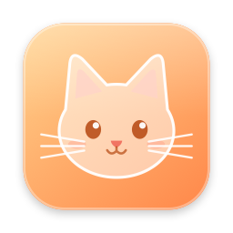
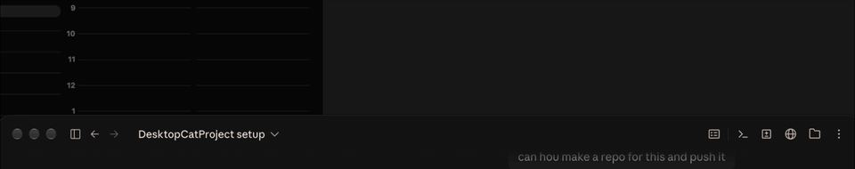

# Desktop Cat



**A free, offline pixel-art cat that lives on your Mac desktop.**



### [⬇️ Download Desktop Cat](https://github.com/hi-dad/desktop-cat/releases/latest/download/DesktopCat.dmg)
Free · macOS 14 or newer · always the latest version

## Install

1. Open **DesktopCat.dmg** and drag Desktop Cat into **Applications**.
2. Open it. When macOS says it can't verify the app, click **Done**, then go to **System Settings → Privacy & Security** and click **Open Anyway** (once).

Everything is in the **cat icon** in your menu bar.

## What the cat does

- Wanders along the bottom of your screen: walks, grooms, stretches and naps.
- Watches your cursor, dozes when you're away, and waves when you're back.
- Pick it up and it dangles by the scruff. Wiggle the cursor to tickle it, or move slowly to pet it.
- Feed it, fill its water bowl, or toss it a ball of yarn. Nothing bad ever happens if you forget.
- Optional extras: chase your cursor, jump onto windows and ride along, or peek over the top of one.
- Two cats to choose from, sizes 1×–6×, and Calm / Normal / Lively moods.

Clicks pass straight through everything but the cat. It rests during full-screen apps and Low Power Mode. No accounts, no network, no special permissions.

**Update:** download again and replace the app. **Remove:** cat icon → **Quit Desktop Cat**, then drag it to the Trash.

<details><summary>Build it yourself</summary>

Needs Xcode or the Command Line Tools.

```bash
./build.sh run    # builds DesktopCat.app and starts it
./build.sh dist   # makes dist/DesktopCat.dmg
swift test        # about 100 tests
```

Code is in `Sources/DesktopCat/`, behaviour and art rules in `specs/`, sprite tools in `tools/sprites/`.

</details>

MIT License
